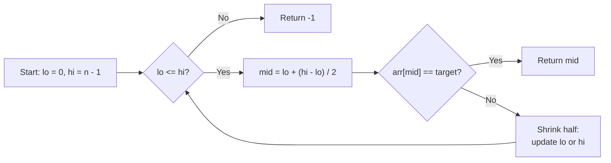

# Concise Inline Diagram Generator (Mermaid-First SVG)

## Core Rule
- Place every diagram **directly inside the same `.md` note** (never create external `.svg` files or asset folders).
- Default to fenced `mermaid` code blocks—Obsidian compiles them into crisp, theme-aware SVGs automatically.

## Mermaid Style Rules (Strict Conciseness)
- Match this clean, compact style:
  - Use `flowchart LR` (horizontal) for algorithms, pipelines, and short steps; `flowchart TD` (vertical) for trees, hierarchies, and tall architectures.
  - Use `sequenceDiagram` for System Design request flows and `stateDiagram-v2` for OS/lifecycle states.
  - Keep diagrams tight: **5 to 10 nodes maximum** per diagram. Split complex systems into two small diagrams rather than one unreadable chart.
  - Always quote node labels (`A["Start: lo = 0, hi = n - 1"]`) so special characters (`=`, `:`, `(`, `)`) never break Obsidian's Mermaid parser.
  - Use ` ` for 2-line wrapping inside nodes to keep boxes compact.
  - Keep edge labels short (`-- "Yes" -->`, `-- "No" -->`, `-- "Hit" -->`).

## Example Template

## Inline <svg> Fallback (Only When Needed)
- Only write raw inline <svg viewBox="0 0 W H" xmlns="http://www.w3.org/2000/svg"> if Mermaid cannot represent the visual (e.g., exact coordinate axes, memory byte grids, or activation curve shapes).

- Keep fallback inline <svg> compact (under 25 lines, single-line elements, no blank lines inside <svg>...</svg> so Obsidian Markdown does not break rendering) with a light rounded backdrop (fill="#F8FAFC") for Dark Mode legibility.

